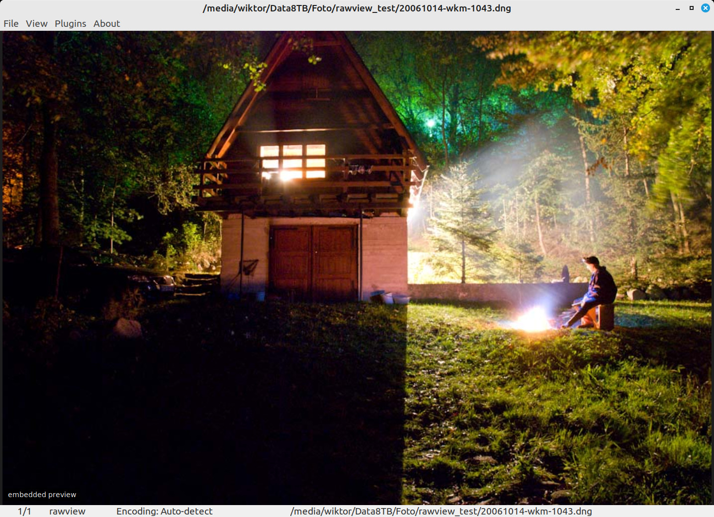
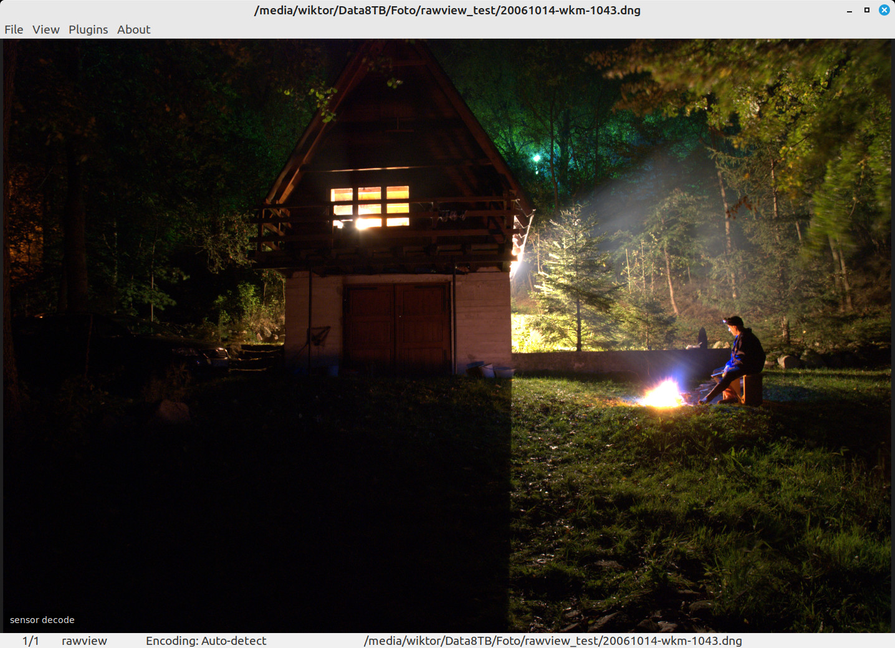

# rawview

A viewer (WLX) plugin for [Double Commander](https://doublecmd.sourceforge.io/)
on Linux that shows camera RAW files in the built-in viewer (F3) and in
Quick View (Ctrl+Q).

It exists to answer one question quickly while browsing: *which photo is
this?* It is not a RAW developer.



## What it shows

The plugin has three sources. **R** or a **double click** cycles through them,
and the choice is kept for the following files until Double Commander is
closed. A small label in the bottom-left corner names the current one.

| Source | What you get | Speed* |
|---|---|---|
| Embedded preview (default) | The JPEG the camera or Lightroom stored inside the file. For DNGs it carries the developed look, but it is often only about 1024 px wide. | 5–150 ms |
| Sensor decode | Full-resolution decode of the sensor data with the camera white balance. Neutral, somewhat flat look. | about 450 ms |
| Sensor detail + preview look | Experimental. The embedded preview upscaled, with the fine detail it lacks added from the sensor decode. | about 650 ms |

\* Measured on 10–12 megapixel files on a desktop CPU.

The same file in each of the three sources (click to enlarge):

<table>
  <tr>
    <th width="33%">Embedded preview</th>
    <th width="33%">Sensor decode</th>
    <th width="33%">Sensor detail + preview look</th>
  </tr>
  <tr>
    <td><a href="docs/embedded.jpg"></a></td>
    <td><a href="docs/sensor.jpg"></a></td>
    <td><a href="docs/transfer.jpg"></a></td>
  </tr>
</table>

The image is always scaled to fit the window. There is no zoom, pan or
rotation.

In Quick View only the double click works. There the plugin lives inside
Double Commander's main window, and taking over a plain letter would break
typing in the file panels.

## Requirements

- Double Commander for Linux, **GTK2 build**. The Qt5/Qt6 builds cannot load
  this plugin.
- LibRaw (`libraw20` or newer) and GTK 2 at run time.

## Download

A prebuilt `rawview.wlx` for x86-64 is attached to each
[release](https://github.com/pywkm/doublecmd-wlx-raw-viewer/releases).

It is built on Ubuntu 22.04 and needs `libraw.so.20`, which Ubuntu 22.04 and
Linux Mint 21 provide (`ldconfig -p | grep libraw` shows what you have). Other
distributions often ship a different LibRaw version; build the plugin yourself
there.

## Build

On Debian, Ubuntu or Mint:

```sh
sudo apt install gcc pkg-config libgtk2.0-dev libraw-dev
./build.sh
```

This produces `rawview.wlx`.

## Install

1. Copy `rawview.wlx` anywhere, for example into
   `plugins/wlx/rawview/` in the Double Commander directory.
2. In Double Commander open *Configuration → Options → Plugins → WLX → Add*
   and select the file. The list of extensions is filled in automatically.
3. Select a RAW file and press F3 or Ctrl+Q.

After replacing the plugin file, restart Double Commander.

## Supported formats

Anything LibRaw can open. The plugin registers itself for these extensions:
NEF, NRW, DNG, CR2, CR3, CRW, ARW, SR2, SRF, RAF, ORF, RW2, PEF, SRW, X3F, ERF,
KDC, DCR, MRW, 3FR, IIQ, RWL and RAW.

**Tested only with Nikon NEF files and with DNG files written by Lightroom.**
The other formats go through the same LibRaw code path and should work, but
nobody has checked them.

## Limitations

- Lightroom edits stored in a DNG are a recipe only Adobe's software can
  render. The plugin never applies them; the only "developed" image it can
  show is the embedded preview, and that is as current as the last time
  Lightroom refreshed it. A crop made later, for example, is often missing.
- The third source assumes the embedded preview shows the whole, uncropped
  frame. If it does not, the plugin detects the mismatch and shows the plain
  preview instead.
- No thumbnails: Double Commander on Linux does not ask viewer plugins for
  them.
- Decoding runs on the UI thread, so the viewer is unresponsive for the
  fraction of a second it takes.

## How the third source works

The preview supplies colour and tone, the sensor decode supplies detail. The
decode is reduced to the preview's size; the difference between the full
decode and that reduced copy is exactly the detail the preview is missing.
That detail is scaled by the local slope of a linear fit between the two
images' luminance (so it follows the preview's tone curve) and added to the
upscaled preview. Where the two images disagree locally, the slope tends to
zero and the result is just the preview.

## License

MIT, see [LICENSE](LICENSE). The plugin links against LibRaw and GTK 2, which
are distributed under their own licenses.
